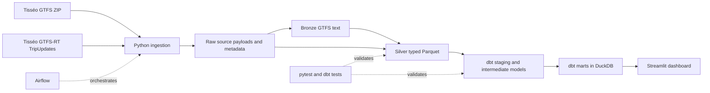

# Mobility Control Tower

Mobility Control Tower is an end-to-end public transport data engineering pipeline built on Tisséo GTFS schedule data and GTFS-Realtime TripUpdates.

The system preserves source data, transforms it into typed analytical datasets, builds transport reliability models with dbt and DuckDB, orchestrates static and realtime workflows with Airflow, and exposes operational and reliability metrics through Streamlit.

## Overview

Published schedules describe planned service, while collected TripUpdates describe only the service observed by the realtime feed. Mobility Control Tower combines both sources without inferring service outcomes from missing observations. A scheduled trip without a matching realtime update remains `UNKNOWN`; it is not classified as cancelled, on time, or delayed.

## Architecture



Python owns collection, source preservation, parsing, Raw, Bronze, Silver, and pre-analytics validation. dbt owns analytical transformations, metric definitions, tests, and marts. DuckDB is the analytical database and dashboard source. See [Architecture](docs/architecture.md) for component boundaries.

## Data Sources

- [Tisséo public dataset](https://transport.data.gouv.fr/datasets/tisseo-reseau-transport-urbain-toulousain)
- Tisséo GTFS schedule ZIP, configured in `config/source.yml`
- Tisséo GTFS-Realtime TripUpdates
- Source licence: ODbL

## Data Pipeline

Static schedule flow:

```text
GTFS ZIP
  → Raw ZIP, metadata, checksum, and ingestion timestamp
  → Bronze selected GTFS text files
  → Silver normalized, typed Parquet
  → dbt models and tests
  → DuckDB marts
```

Realtime flow:

```text
GTFS-RT TripUpdates
  → Raw protobuf, metadata, checksum, and collection timestamp
  → Silver feed, trip, and stop-time Parquet partitions
  → dbt models and tests
  → DuckDB marts
```

Static runs receive UTC run identifiers. Realtime snapshot identifiers combine the publisher timestamp with the payload checksum, so retries of identical content are idempotent. Arrival delay is preferred when present; departure delay is the fallback.

## Data Model

The dbt project contains 17 models:

- Staging: `stg_routes`, `stg_trips`, `stg_stops`, `stg_stop_times`, `stg_calendar`, `stg_calendar_dates`, `stg_realtime_updates`, `stg_feed_snapshots`
- Intermediate: `int_service_dates`, `int_scheduled_trips`, `int_delay_observations`
- Marts: `route_daily_service`, `route_delay_summary`, `hourly_delay_summary`, `network_on_time_performance`, `realtime_coverage`, `feed_freshness`

Grains, keys, relationships, and metric contracts are documented in [Data Model](docs/data_model.md).

## Metrics and Data Semantics

| Metric or status | Definition |
| --- | --- |
| Scheduled trips | Distinct trips active for a route and GTFS service date |
| Realtime coverage | Exactly matched realtime trips divided by eligible scheduled trips |
| On-time window | Delay from -60 through +300 seconds, inclusive |
| Eligible delay | Known delay within ±7,200 seconds |
| Delay statistics | Average, median, and P90 over eligible matched stop-time observations |
| Reliable sample | At least 5 eligible observations; smaller groups are `LOW_SAMPLE` |
| Feed freshness | `FRESH` through 90 seconds, `DELAYED` through 300 seconds, then `STALE` |
| Missing publisher time | `UNKNOWN` freshness |
| Missing realtime match | `UNKNOWN` service observation |

Values outside the delay sanity bound are retained as `OUT_OF_RANGE` but excluded from reliability denominators. On-time performance is observation-weighted and should be interpreted with realtime coverage and sample status.

## Data Quality

Python checks validate:

- required GTFS files and nonblank identifiers;
- unique route, trip, stop, and trip/stop-sequence keys;
- trip-to-route and stop-time relationships;
- GTFS times, including values after 24:00 such as `25:05:00`;
- realtime snapshot lineage and within-snapshot uniqueness;
- delay sanity conditions.

dbt adds `not_null`, `unique`, `relationships`, and `accepted_values` tests, plus assertions for percentage bounds, delay eligibility, coverage reconciliation, and metric numerators and denominators.

## Orchestration

Airflow defines exactly two DAGs:

- `static_gtfs_pipeline`, scheduled daily at 03:00 UTC: `download_and_preserve → build_silver → quality_checks → dbt_build`
- `realtime_pipeline`, scheduled every five minutes: `fetch_parse_and_append → quality_checks → dbt_build`

Both DAGs call the same tested Python functions exposed by the CLI workflows.

## Dashboard

The Streamlit application has three sections:

1. Network Overview
2. Route Reliability
3. Data Quality / Feed Health

Delay seconds and on-time percentages are plotted separately. Empty states remain visible when observations are unavailable, `LOW_SAMPLE` warnings identify small groups, and coverage is presented alongside reliability metrics.

## Technology Stack

Python, GTFS, GTFS-Realtime, Parquet, dbt, DuckDB, Apache Airflow, Streamlit, pytest, Docker, Docker Compose, and GitHub Actions.

## Getting Started

Python 3.11 is supported.

```bash
python -m venv .venv
source .venv/bin/activate  # Windows PowerShell: .venv\Scripts\Activate.ps1
python -m pip install -e ".[dev,analytics]"
```

Install the `orchestration` dependency group when running or validating Airflow outside Docker:

```bash
python -m pip install -e ".[orchestration]"
```

## Configuration

Source URLs, timezone, licence, and freshness thresholds are defined in `config/source.yml`. Runtime paths can be overridden with:

- `MCT_DATA_ROOT`
- `MCT_DBT_DATABASE_PATH`

dbt receives the active source paths and analytical thresholds from the Python runner.

## Running the Pipelines

```bash
mct static-pipeline
mct collect-realtime
mct dbt-build
streamlit run dashboard/app.py
```

After a static run exists, one complete realtime poll can be executed with:

```bash
mct realtime-pipeline
```

Run `mct --help` for the complete command list.

## Deterministic Fixture

Tests and CI use source-controlled GTFS records plus a generated GTFS-Realtime protobuf:

```bash
python scripts/create_ci_fixture.py data/ci
mct --data-root data/ci dbt-build --static-run data/ci/silver/static/20260101T120000000000Z
```

The fixture command resets only the requested child directory under `data/`. Repeated runs generate the same files and metadata.

To inspect the fixture database in Streamlit:

```bash
MCT_DBT_DATABASE_PATH=data/ci/mart/mobility_control_tower.duckdb streamlit run dashboard/app.py
```

In Windows PowerShell, set the path with `$env:MCT_DBT_DATABASE_PATH = "data/ci/mart/mobility_control_tower.duckdb"` before launching Streamlit.

## Testing

```bash
ruff check .
black --check .
isort --check-only .
mypy src
coverage run -m pytest
coverage report --fail-under=80
python scripts/create_ci_fixture.py data/ci
mct --data-root data/ci dbt-build --static-run data/ci/silver/static/20260101T120000000000Z
docker compose config --quiet
```

The GitHub Actions workflow runs Python quality checks, tests with the configured coverage threshold, the deterministic dbt build, and a container image build.

## Docker

```bash
cp .env.example .env
docker compose up --build
```

- Streamlit: `http://localhost:8501`
- Airflow: `http://localhost:8080` (`airflow` / `airflow`)

Compose runs Airflow initialization, the webserver, the scheduler, and Streamlit against the shared `data/` volume.

## Project Structure

```text
.
├── src/mobility_control_tower/  # ingestion, normalization, quality, dbt runner, CLI
├── dbt/models/                  # staging, intermediate, and marts
├── airflow/dags/                # two orchestration workflows
├── dashboard/app.py             # Streamlit application
├── scripts/create_ci_fixture.py # deterministic CI data
├── tests/                       # Python tests and source fixtures
├── config/source.yml            # Tisséo source configuration
├── docs/                        # architecture and data model
├── Dockerfile
└── docker-compose.yml
```

Runtime data, DuckDB files, dbt targets and logs, Airflow state, coverage output, caches, local environment files, and package metadata are ignored by Git.

## Technical Limitations

- Realtime analysis depends on the availability and completeness of the upstream GTFS-Realtime feed.
- Matching relies on compatible GTFS and GTFS-Realtime trip identifiers.
- When `start_date` is absent, the Europe/Paris observation date is used as the service-date fallback.
- Missing realtime observations remain `UNKNOWN` rather than being inferred as cancellations.
- Results depend on the duration and cadence of collected snapshots.
- Local execution uses DuckDB and Docker Compose; Airflow state is stored in SQLite.
