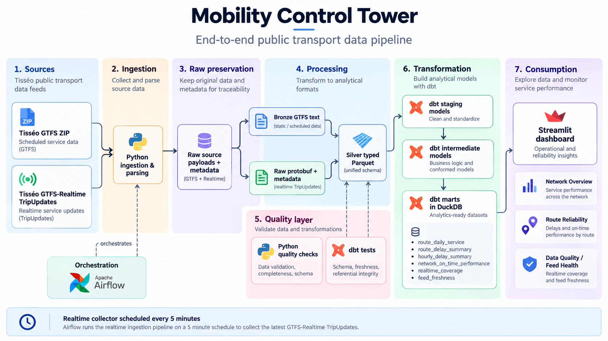
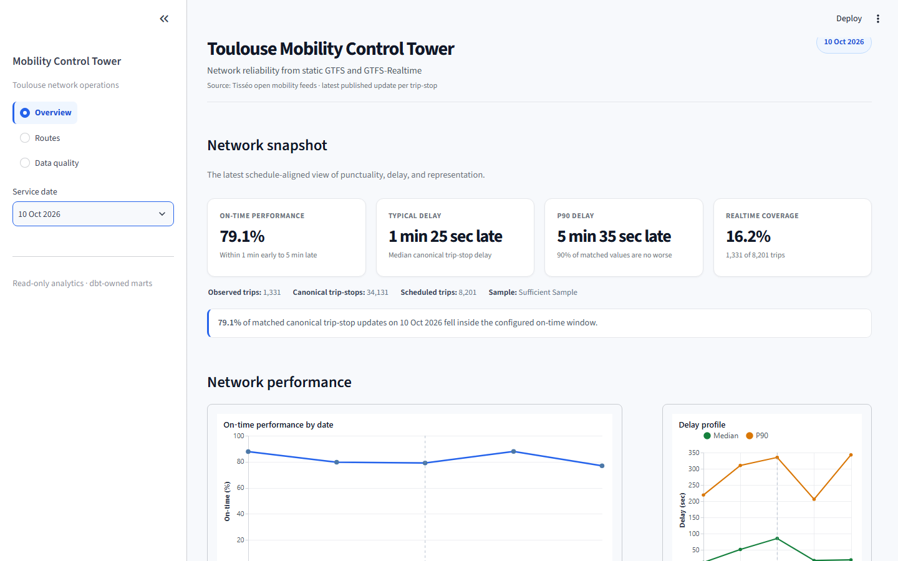

# Mobility Control Tower

Mobility Control Tower is an end-to-end public transport data platform built on Tisséo GTFS schedules and GTFS-Realtime TripUpdates. It preserves source history, converts it into typed analytical datasets, reconciles published realtime updates with scheduled service, and exposes reliability and feed-health metrics through DuckDB, dbt, and Streamlit.

## What it solves

Published schedules describe planned service; TripUpdates describe only what the realtime feed reported. Mobility Control Tower combines the two without turning missing data into service outcomes. A scheduled trip without a valid realtime match remains `UNKNOWN`: it is never inferred to be cancelled, delayed, or on time.

## Architecture

<p align="center">
  <a href="docs/images/architecture.png">
    
  </a>
</p>

Python owns collection, immutable source preservation, parsing, Raw/Bronze/Silver processing, and pre-analytics validation. dbt owns schedule expansion, canonical observation construction, analytical tests, and marts. DuckDB is the analytical database and the read-only source for Streamlit. Airflow schedules the static and five-minute realtime workflows. See [Architecture](docs/architecture.md) for the component boundaries.

## Data pipeline

```text
GTFS ZIP → Raw ZIP + metadata → Bronze text → Silver Parquet ┐
                                                              ├→ dbt → DuckDB marts → Streamlit
GTFS-RT  → Raw protobuf + metadata → Silver Parquet ──────────┘
```

Static runs receive UTC run identifiers. Realtime snapshot identifiers combine the publisher timestamp with the payload checksum, making identical retries idempotent. Poll-level history remains available for lineage and feed-health analysis; reliability metrics use a separate canonical grain.

## Real-world run

The collector accumulated 1,436 unique TripUpdate snapshots across 17 UTC dates, after which the analytical layer was rebuilt over the complete local history. The result contains 266,806 canonical trip-stop observations. Five of the 17 realtime-history dates overlap the available static GTFS validity window and can support schedule-comparison metrics.

At the end of the run, the latest feed was `FRESH` with a seven-second publisher age. In the latest 24-hour window, 85 of 86 snapshots were fresh (98.8%).

Representative network results for 10 October 2026:

| Metric | Result |
| --- | ---: |
| On-time performance | 79.1% |
| Median published delay | 1 min 25 sec late |
| P90 published delay | 5 min 35 sec late |
| Observed trips | 1,331 |
| Canonical trip-stop records | 34,131 |
| Eligible scheduled trips | 8,201 |
| Realtime trip coverage | 16.2% |

Delay metrics represent the latest canonical published GTFS-Realtime update for each matched trip-stop. They are neither passenger-weighted nor verified physical arrival measurements. On-time means the published delay is between 1 minute early and 5 minutes late, inclusive.

See [Real-world Results and Engineering Findings](docs/results.md) for the collection window, route example, source-quality diagnostics, and interpretation limits.

## Engineering findings

### Repeated polling is not independent service data

The feed is polled every five minutes, so the same trip-stop can appear in many snapshots. Counting every poll as an independent observation would inflate sample sizes and bias delay statistics. The final analytical model collapses that history to the latest valid published observation per `service_date`, `trip_id`, and `stop_sequence`; poll-level records remain preserved for lineage and feed-health analysis.

### Source duplicates and ambiguity

The upstream feed contains exact duplicate source keys, conflicting stop or delay values, missing delays, and delays outside the configured ±7,200-second sanity bound. Raw and Silver preserve the source exactly. The analytical layer may collapse exact duplicates, excludes ambiguous observations and out-of-range delays from reliability KPIs, and retains missing delays as unknown.

### Schedule and realtime compatibility

A realtime trip is matched only when the same `trip_id` exists in the static schedule for the same service date. Historical realtime dates outside the available static GTFS window remain useful for feed-health history, but cannot produce schedule-comparison KPIs.

### Missing observations remain unknown

A scheduled trip without a valid realtime match remains `UNKNOWN`. Absence from the feed is not evidence of cancellation, delay, or punctuality.

### Local analytical scalability

Accumulated history made repeated Parquet scans memory-intensive. The final local design materializes the expensive canonical intermediates, runs dbt with one DuckDB thread and a 2 GB memory limit, allows disk spilling, and prevents downstream marts from recomputing the full history repeatedly.

## Data sources

- [Tisséo public dataset](https://transport.data.gouv.fr/datasets/tisseo-reseau-transport-urbain-toulousain)
- Tisséo GTFS schedule ZIP configured in `config/source.yml`
- Tisséo GTFS-Realtime TripUpdates
- Source licence: ODbL

Arrival delay is preferred when present; departure delay is the fallback.

## Data model

The dbt project contains 19 models:

- Staging (8): `stg_routes`, `stg_trips`, `stg_stops`, `stg_stop_times`, `stg_calendar`, `stg_calendar_dates`, `stg_realtime_updates`, `stg_feed_snapshots`
- Intermediate (4): `int_service_dates`, `int_scheduled_trips`, `int_delay_observations`, `int_trip_stop_observations`
- Marts (7): `route_daily_service`, `route_delay_summary`, `hourly_delay_summary`, `network_on_time_performance`, `realtime_coverage`, `feed_freshness`, `data_coverage_summary`

Grains, keys, relationships, and metric contracts are documented in [Data Model](docs/data_model.md).

## Metric definitions

| Metric or status | Definition |
| --- | --- |
| On-time | Latest canonical published delay from -60 through +300 seconds, inclusive |
| Median delay | Median canonical matched trip-stop delay |
| P90 delay | Value at or below which 90% of canonical matched delays fall |
| Coverage | Distinct scheduled trips with a valid realtime match divided by eligible scheduled trips on a schedule-compatible service date |
| Unknown | Scheduled trip without a valid realtime match; no service outcome is inferred |
| Feed freshness | Age of the publisher timestamp when the snapshot was collected |
| Sample size | Number of canonical matched trip-stop records behind a statistic |
| Sufficient sample | At least 30 canonical trip-stop records; smaller groups are `LOW_SAMPLE` |

## Data quality and testing

Python validation checks required GTFS files and identifiers, keys and relationships, GTFS times after 24:00, realtime lineage, duplicate observations, and delay sanity. dbt adds key, relationship, accepted-value, reconciliation, eligibility, percentage-bound, and sample-status assertions.

The current repository contains 28 Python tests, 57 dbt data tests, and 9 dbt unit tests. The dbt project builds 19 models.

## Orchestration

Airflow defines two DAGs:

- `static_gtfs_pipeline`, daily at 03:00 UTC: `download_and_preserve → build_silver → quality_checks → dbt_build`
- `realtime_pipeline`, every five minutes: `fetch_parse_and_append → quality_checks → dbt_build`

Both DAGs call the same tested package functions exposed through the CLI.

## Dashboard

The light-theme dashboard separates network performance, route analysis, and source coverage so that reliability figures are always shown with their evidence base.

[](docs/images/dashboard/overview.png)

Additional views: [Routes](docs/images/dashboard/routes.png) · [Data quality](docs/images/dashboard/data-quality.png)

The navigation sections are `Overview`, `Routes`, and `Data quality`. Empty states remain visible when observations are unavailable, `LOW_SAMPLE` labels identify small groups, and coverage is shown alongside reliability metrics.

## Technology stack

Python, GTFS, GTFS-Realtime, Parquet, dbt, DuckDB, Apache Airflow, Streamlit, pytest, Docker, Docker Compose, and GitHub Actions.

## Getting started

Python 3.11 or later is supported.

```bash
python -m venv .venv
source .venv/bin/activate  # Windows PowerShell: .venv\Scripts\Activate.ps1
python -m pip install -e ".[dev,analytics]"
```

Install the orchestration dependencies when running or validating Airflow outside Docker:

```bash
python -m pip install -e ".[orchestration]"
```

## Configuration

Source URLs, timezone, licence, and freshness thresholds are defined in `config/source.yml`. Runtime paths can be overridden with `MCT_DATA_ROOT` and `MCT_DBT_DATABASE_PATH`. dbt receives the active source paths and analytical thresholds from the Python runner.

## Running the pipelines

```bash
mct static-pipeline
mct collect-realtime
mct dbt-build
streamlit run dashboard/app.py
```

After a static run exists, one complete realtime poll can be executed with `mct realtime-pipeline`. Run `mct --help` for the complete command list.

## Deterministic fixture

Tests and CI use source-controlled GTFS records plus a generated GTFS-Realtime protobuf:

```bash
python scripts/create_ci_fixture.py data/ci
mct --data-root data/ci dbt-build --static-run data/ci/silver/static/20260101T120000000000Z
```

The fixture command resets only the requested child directory under `data/`. Repeated runs generate the same files and metadata.

To inspect the fixture database in Streamlit:

```bash
MCT_DBT_DATABASE_PATH=data/ci/mart/mobility_control_tower.duckdb streamlit run dashboard/app.py
```

In Windows PowerShell, set the path with `$env:MCT_DBT_DATABASE_PATH = "data/ci/mart/mobility_control_tower.duckdb"` before launching Streamlit.

## Testing

```bash
ruff check .
black --check .
isort --check-only .
mypy src
coverage run -m pytest
coverage report --fail-under=80
python scripts/create_ci_fixture.py data/ci
mct --data-root data/ci dbt-build --static-run data/ci/silver/static/20260101T120000000000Z
docker compose config --quiet
```

GitHub Actions runs Python quality checks, tests with the configured coverage threshold, the deterministic dbt build, and a container image build.

## Docker

```bash
cp .env.example .env
docker compose up --build
```

- Streamlit: `http://localhost:8501`
- Airflow: `http://localhost:8080` (`airflow` / `airflow`)

Compose runs Airflow initialization, webserver, scheduler, and Streamlit against the shared `data/` volume.

## Project structure

```text
.
├── src/mobility_control_tower/  # ingestion, normalization, quality, dbt runner, CLI
├── dbt/models/                  # staging, intermediate, and marts
├── airflow/dags/                # two orchestration workflows
├── dashboard/app.py             # Streamlit application
├── scripts/create_ci_fixture.py # deterministic CI data
├── tests/                       # Python tests and source fixtures
├── config/source.yml            # Tisséo source configuration
├── docs/                        # architecture, data model, results, and images
├── Dockerfile
└── docker-compose.yml
```

Runtime data, DuckDB files, dbt targets and logs, Airflow state, coverage output, caches, local environment files, and package metadata are ignored by Git.

## Technical limitations

- TripUpdates are published realtime updates, not guaranteed ground-truth arrivals.
- Results are not passenger-weighted.
- Schedule comparison requires compatible static GTFS history and exact date-aware trip matching.
- Coverage depends on upstream TripUpdate completeness and collection cadence.
- Local rebuilds scan a growing history, although the canonical path is materialized and memory-bounded.
